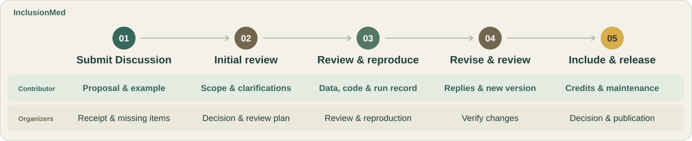

# Contributing to InclusionMed

[Project overview](README.md) · [Website](https://knight-flash.github.io/InclusionMed/) · [中文](CONTRIBUTING.zh-CN.md)

Bring a healthcare task, recommend a benchmark or share expertise. An idea is enough to start; collaborators can help prepare data and code. English and Chinese are both welcome.

## Where to start

| Contribution | What to share | Entry point |
| :--- | :--- | :--- |
| **Healthcare task** | Healthcare need, input/output example, evaluation approach and support needed | [Discussion](https://github.com/knight-flash/InclusionMed/discussions) |
| **Existing benchmark** | Paper, data and code links, evaluation method, use conditions and added coverage | [Discussion](https://github.com/knight-flash/InclusionMed/discussions) |
| **Review or expertise** | Relevant experience, languages or local context, work you can help with and availability | [Discussion](https://github.com/knight-flash/InclusionMed/discussions) |

All three contribution types start in Discussions. Search existing discussions, continue in a relevant one or start a new Discussion. The following process applies to tasks and benchmarks; collaborators can join the relevant stage.

## From proposal to inclusion

### 1. Submit a Discussion

Use a clear title, such as `[Task] Plain-language appointment instructions` or `[Benchmark] Benchmark name`. Include the following in the body, or use the [proposal template](assets/docs/inclusionmed-task-proposal.md):

- **Need and scope:** intended users, healthcare setting, work to complete and relationship to existing evaluations.
- **Task type:** MCQ (multiple-choice questions), QA (open-ended answers) or Agent; describe each subtask in a mixed benchmark.
- **Example and scoring:** a shareable input, expected output and how completion would be judged.
- **Sources and access:** available papers, data, code or professional references, with known use and access conditions.
- **Contribution and support:** materials you can provide, help needed and a contact account.

To offer review or expertise, describe your background, the work you can help with and your availability in the Discussion.

A complete dataset, implementation or evaluation run is optional at this stage. Mark unknowns as “to confirm”; benchmark recommendations can link existing documentation. Public text, attachments and logs must contain no patient identifiers, credentials or restricted source data. Describe controlled materials and agree a sharing method with the organizers.

### 2. Initial review

The organizers give a **first response within 5 working days**, acknowledge receipt and identify missing information. Once they confirm the initial proposal is complete, they **complete initial review within 15 working days**.

Initial review covers healthcare relevance, professional evidence, overlap, use conditions and feasibility. The organizers record one of these outcomes in the original Discussion:

- **Proceed to detailed review:** define scope, required materials, collaborators and the next step.
- **Request information:** list the questions and evidence needed for a reply in the same discussion.
- **Defer or decline:** explain the reasons and any conditions for reconsideration.

The organizers record the completeness date, current status, owner and next action date. After initial review, both sides agree the evaluation scope, resource providers and review arrangements.

### 3. Prepare materials, review and reproduce

Prepare the review package using [Data and code baseline v0.1](assets/docs/task-format.md). Link files or repositories for the same version in the original Discussion:

| Material | Required content |
| :--- | :--- |
| Task description | Intended users, scope, task type, version, languages and coverage |
| Data and references | Field definitions, sample IDs, splits, sources and permissions, reference answers or rubrics, human review record |
| Code and environment | Pinned code and dependencies, configuration, setup, small-trial, full-evaluation and scoring commands |
| Runs and results | Small-sample checks, full evaluation outputs, failures and an [evaluation record](assets/docs/inclusionmed-evaluation-checklist.md) |

Contributors and collaborators can share data preparation and implementation. Existing benchmarks can retain upstream formats and provide an adapter, preserving original IDs, versions and mappings. The organizers identify missing materials and who will prepare them.

Medical reviewers check professional evidence, reference answers, rubrics and critical errors. Technical reviewers check formats, execution, scoring and failure handling. An authorized reviewer who did not produce the reported run independently reproduces the agreed scope and records versions, configuration, results and discrepancies. Agree access approvals, compute and costs before running controlled-data evaluations.

### 4. Revise and review again

The organizers consolidate feedback in the original Discussion, identifying required changes, reasons, owners and a review date. Reply to each item with the change made or evidence supporting your position. Link the new version, summarize changes and checks, then post “Materials updated; ready for review.”

Changes to the objective, scope, data permissions or scoring require the organizers to revisit the relevant initial-review decisions. Formatting and implementation fixes go directly to revision review. Record execution failures and rerun plans separately. Changes to data, prompts or scoring require a new task version; previous results keep their original version.

Reviewers confirm resolution under each review item. The organizers then record **accept, request further revisions, defer or decline**, with reasons. Continue in the same Discussion; submit file changes through a linked PR or versioned materials.

### 5. Include and release

The organizers confirm that professional review, technical checks and independent reproduction are complete and that issues affecting validity are resolved. The final reviewer must be independent of the contribution; reviewers disclose relevant conflicts of interest.

The inclusion record names the task version, review decision, reproduction evidence, scope, limitations, contributor roles and maintenance contact. Before release, confirm which materials will be public, which require controlled access and the release date. The organizers then add the inclusion entry, data and code versions, and release links to the original Discussion.

PR merging, task inclusion and result publication are recorded separately. Task acceptance does not automatically admit every evaluation result. Agree any paper authorship with the project team before publication.

## Review timing

| Stage | Organizer target |
| :--- | :--- |
| First response | Acknowledge receipt and identify gaps within **5 working days** of submission |
| Initial review | Record the decision and next step within **15 working days** of confirming the initial proposal is complete |
| Detailed review and reproduction | Agree dates in the original Discussion once materials, access and resources are ready |
| Revision review and release | Record the next action or release date when revised materials arrive or the contribution is accepted |

Working days exclude weekends and the organizing team's public holidays; the organizers record calendar deadlines. Waiting for materials, access approval or agreed resources pauses the affected stage. Record the reason and update the deadline using the remaining working days when work resumes. If a deadline will be missed, post progress and a new date before it is due. Contributors can follow up in the original Discussion after a deadline passes.

## Data and code baseline

See [Data and code baseline v0.1](assets/docs/task-format.md) for fields, examples and package layout. Review packages follow these conventions:

Contributors define evaluation methods according to their task goals. Document the judgment criteria, metric meanings, calculation or decision procedure, and handling of failures, missing results and retries. Each task determines its dimensions, scales, weights, thresholds and aggregation; organizers review the supporting evidence and reproducibility.

| Task type | Input and output | Scoring materials |
| :--- | :--- | :--- |
| **[MCQ](assets/docs/task-format.md#mcq)** | Question, context and choices; return one or more choice IDs | Answer evaluation method, chosen metrics and judgment criteria |
| **[QA](assets/docs/task-format.md#qa)** | Prompt or conversation context; return a free-text answer | Task-defined evaluation method, human-reviewed criteria and disagreement resolution |
| **[Agent](assets/docs/task-format.md#agent)** | Goal, initial environment and available tools; return a result or artifact | Environment reset, action and resource limits, completion criteria, state verification and complete tool traces |

- **Data:** use UTF-8 JSONL, one object per sample, with stable unique IDs. Store model inputs separately from answers and rubrics. Document sources, licences, splits, duplicates, languages and population coverage.
- **Professional evidence:** qualified people author and review reference answers and evaluation criteria, recording sources, scope and any task-defined answer variants or critical errors. LLM-generated annotations cannot serve as the reference standard. Disclose AI assistance and human review.
- **Code:** use Python 3.11 as the baseline for new implementations, 4-space indentation and Ruff formatting and linting. Existing implementations can retain their language and tools. Separate loading, model calls and scoring; pin dependencies and provide repeatable commands.
- **Results:** link outputs to sample IDs, task versions and run IDs. Record success, invalid output, timeout, tool error, infrastructure error and unrun cases. Retain failed samples and state scoring rules, denominators and incomplete work.
- **Checks:** provide a small trial covering fields, ID alignment, scoring and failures, plus reset and state checks for Agent tasks. Deliver large files through versioned links; read credentials from environment variables.

## Share materials in the Discussion

Link the task, data, code and evaluation record in the original Discussion, retaining review feedback and decisions there. When repository files need changing, agree file placement with the organizers, fork the repository, make changes on a branch and open a linked PR against `knight-flash/InclusionMed:main`.

Link the Discussion in the PR, describe changes and versions, and list completed checks. Use a draft PR while materials are incomplete; mark it ready and update the discussion when complete. Evaluation implementations may live in a separate repository with a pinned commit. Use the agreed access method for controlled materials.

Before requesting review:

- [ ] The proposal, data, code and evaluation record refer to the same task version.
- [ ] Sources, use conditions, human review and reproduction records are provided; incomplete items are identified.
- [ ] Files and logs contain no patient identifiers, credentials or material without permission for publication.
- [ ] Relevant checks pass, links and images work, and English and Chinese descriptions agree.
