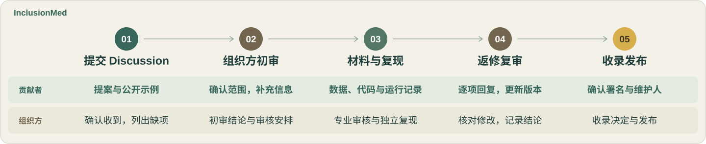

# 参与 InclusionMed 共建

[项目介绍](README.zh-CN.md) · [项目网站](https://knight-flash.github.io/InclusionMed/) · [English](CONTRIBUTING.md)

你可以提出医疗任务、推荐已有基准或提供专业经验。有一个想法就可以开始交流，数据和代码可以与协作者共同补齐。中英文均可。

## 从哪里开始

| 参与方式 | 提交内容 | 入口 |
| :--- | :--- | :--- |
| **医疗任务** | 医疗需求、输入输出示例、评测思路和需要的协助 | [Discussion](https://github.com/knight-flash/InclusionMed/discussions) |
| **现有基准** | 论文、数据与代码链接，评测方法、使用条件及新增覆盖 | [Discussion](https://github.com/knight-flash/InclusionMed/discussions) |
| **审核或专业经验** | 专业背景、语言或本地经验、可协助的工作与时间 | [Discussion](https://github.com/knight-flash/InclusionMed/discussions) |

三种参与方式均通过 Discussion 开始。先搜索已有讨论，相关内容沿用原讨论，没有对应内容时新建 Discussion。以下流程适用于任务和基准；专业协作者可以加入相应阶段。

## 从提案到收录

### 1. 提交 Discussion

使用清楚的标题，例如 `[Task] 通俗易懂的预约说明` 或 `[Benchmark] 基准名称`。在正文填写以下内容，也可以使用 [提案模板](assets/docs/inclusionmed-task-proposal.md)：

- **需求与范围：** 服务对象、医疗场景、需要完成的工作，以及与已有评测的关系。
- **任务形式：** MCQ（选择题）、QA（开放式回答）或 Agent；混合基准分别说明各子任务。
- **示例与评分：** 一份可公开的输入、预期输出及判断完成质量的方法。
- **来源与权限：** 已有论文、数据、代码或专业依据，以及已知的使用和访问条件。
- **参与与支持：** 你能提供的材料、需要的协助，以及联系账号。

参与审核或提供专业经验时，在 Discussion 中说明专业背景、可协助的工作和可投入的时间。

初始提案可以没有完整数据、代码或评测结果。不确定的内容标记为“待确认”；推荐已有基准时可链接其文档。公开正文、附件和日志中不得包含患者标识、密钥或受限原始数据。受控材料先说明访问条件，与组织方约定共享方式。

### 2. 组织方初审

组织方在 **5 个工作日内首次回复**，确认收到并列出需要补充的信息。确认初始提案齐全后，在 **15 个工作日内完成初审**。

初审检查医疗相关性、专业依据、与已有工作的重合、材料使用条件和实现可行性，并在原 Discussion 记录结论：

- **进入详细审核：** 明确任务范围、需补齐的材料、协作者和下一步。
- **补充信息：** 逐项列出问题及所需证据，贡献者在原讨论回复。
- **暂缓或不接纳：** 说明依据，以及是否具备再次提交的条件。

组织方记录材料齐全日期、当前状态、负责人和下次处理日期。通过初审后，双方再确认评测范围、资源提供方与审核安排。

### 3. 准备材料，审核与复现

按照 [数据与代码基准 v0.1](assets/docs/task-format.zh-CN.md) 准备审核材料，在原 Discussion 链接同一版本的文件或仓库：

| 材料 | 需要包含什么 |
| :--- | :--- |
| 任务说明 | 目标用户、范围、任务形式、版本、语言与覆盖情况 |
| 数据与参考 | 字段说明、样本 ID、划分、来源与许可、参考答案或评分规则、人工审核记录 |
| 代码与环境 | 固定版本的代码和依赖，配置，安装、试跑、完整评测与评分命令 |
| 运行与结果 | 小样本检查、完整评测输出、失败记录和 [评测记录](assets/docs/inclusionmed-evaluation-checklist.md) |

贡献者可以与协作者分担数据整理和实现。已有基准可以保留上游格式，通过适配器接入，并记录原始 ID、版本和映射。材料不足时，组织方明确缺项和承接人。

医学审核人检查专业依据、参考答案、评分规则和关键错误；技术审核人检查格式、运行条件、评分实现和失败处理。由未参与该次结果产出的授权审核人按约定范围独立复现，记录版本、配置、结果与差异。受控数据的访问审批、算力和费用在运行前确定。

### 4. 返修与复审

组织方在原 Discussion 汇总审核意见，列出必须修改的项目、原因、负责人和复审日期。贡献者逐项回复“已修改”或说明保留意见的依据，链接新版本，并写明修改和检查结果。完成后留言“材料已更新，申请复审”。

修改研究目标、任务范围、数据权限或评分规则时，由组织方重新确认相关初审结论；格式和实现修正直接进入复审。运行故障单独记录原因和重跑安排。数据、提示词或评分变化时更新任务版本，历史结果保留原版本标记。

审核人在同一条意见下确认是否解决。组织方随后记录 **接纳、继续返修、暂缓或不接纳**，并说明依据。返修沿用原 Discussion；文件修改通过关联的 PR 或版本链接提交。

### 5. 最终收录与发布

组织方确认专业审核、技术检查和独立复现均已完成，且影响有效性的问题已解决。最终审核人应独立于该项贡献；审核人说明相关利益冲突。

收录记录包括任务版本、审核结论、复现证据、适用范围、已知限制、贡献者角色和维护联系人。发布前确认哪些材料公开、哪些按访问条件提供，并约定发布日期。发布后，组织方在原 Discussion 补充收录条目、数据与代码版本及发布链接。

PR 合并、任务收录和结果发布分别记录。接纳任务不代表自动纳入所有评测结果。涉及论文署名时，在发表前与项目团队确认。

## 审核时间

| 阶段 | 组织方处理目标 |
| :--- | :--- |
| 首次回复 | 提交后 **5 个工作日内**确认收到并列出缺项 |
| 初审 | 确认初始提案齐全后 **15 个工作日内**给出结论与下一步 |
| 详细审核与复现 | 收齐材料并确认访问和资源后，在原 Discussion 约定具体日期 |
| 返修复审与发布 | 收到更新材料或作出接纳决定时，记录下一次处理或发布日期 |

工作日不含周末及组织方所在地法定假日，组织方写明具体截止日期。等待补材料、访问审批或约定资源时，记录暂停原因；恢复后按剩余工作日更新期限。预计延期时，在到期前说明进展并给出新日期。超过约定日期后，贡献者可在原 Discussion 跟进。

## 数据与代码基准

详细字段、示例和目录见 [数据与代码基准 v0.1](assets/docs/task-format.zh-CN.md)。审核材料采用以下约定：

评估方法由贡献者根据任务目标自行定义。提交材料需说明判断依据、指标含义、计算或判定方法，以及失败、缺失结果和重试的处理方式。评分维度、分值、权重、阈值与聚合方式均由任务确定，组织方审核其依据与可复现性。

| 任务形式 | 输入与输出 | 评分材料 |
| :--- | :--- | :--- |
| **[MCQ](assets/docs/task-format.zh-CN.md#mcq)** | 问题、上下文和选项；输出一个或多个选项 ID | 答案评价方法、所选指标与判断依据 |
| **[QA](assets/docs/task-format.zh-CN.md#qa)** | 问题或对话上下文；输出自由文本回答 | 任务定义的评估方法、人工审核依据和分歧处理方式 |
| **[Agent](assets/docs/task-format.zh-CN.md#agent)** | 任务目标、初始环境与可用工具；输出结果或产物 | 环境重置、操作与资源限制、完成条件、状态核验和完整工具轨迹 |

- **数据：** 文本使用 UTF-8，样本使用 JSONL，每行一个对象；样本 ID 稳定且唯一。模型输入与参考答案、评分规则分开存放。说明来源、许可、划分、重复样本、语言和人群覆盖。
- **专业依据：** 参考答案和评估依据由具备相关专业能力的人员编写、审核，记录来源、适用范围及按任务定义的答案变体或关键错误。LLM 生成的标注不能作为参考标准；AI 辅助用途和人工审核过程需说明。
- **代码：** 新实现以 Python 3.11 为基准，使用 4 空格缩进和 Ruff 格式化、检查；已有实现可以保留原语言和工具。分开组织读取、模型调用和评分，固定依赖，提供可重复执行的命令。
- **结果：** 输出关联样本 ID、任务版本和运行 ID，记录成功、无效输出、超时、工具错误、基础设施错误和未运行项。失败样本保留记录，结果说明计分方法、分母和未完成部分。
- **检查：** 提供小样本试跑，核对字段、ID 对齐、评分、失败处理，以及 Agent 的重置和状态核验。大文件通过版本链接交付，凭据通过环境变量读取。

## 在 Discussion 中提交材料

在原 Discussion 中链接任务、数据、代码和评测记录，保留审核意见与决定。需要修改本仓库公开文件时，与组织方确认存放位置后，Fork 本仓库，在分支中修改，并向 `knight-flash/InclusionMed:main` 提交关联 PR。

PR 描述应关联 Discussion，说明修改、版本和已完成的检查。材料未齐时使用 Draft PR；完成后标记为可审核，并在原讨论中更新链接。评测实现可放在独立仓库，提供固定提交版本；受控材料使用约定的访问方式。

申请审核前确认：

- [ ] 提案、数据、代码和评测记录对应同一任务版本。
- [ ] 来源、使用条件、人工审核和复现记录齐全，未完成项已注明。
- [ ] 文件与日志无患者标识、密钥或未经授权公开的材料。
- [ ] 相关检查通过，链接与图片可访问，中英文说明一致。
